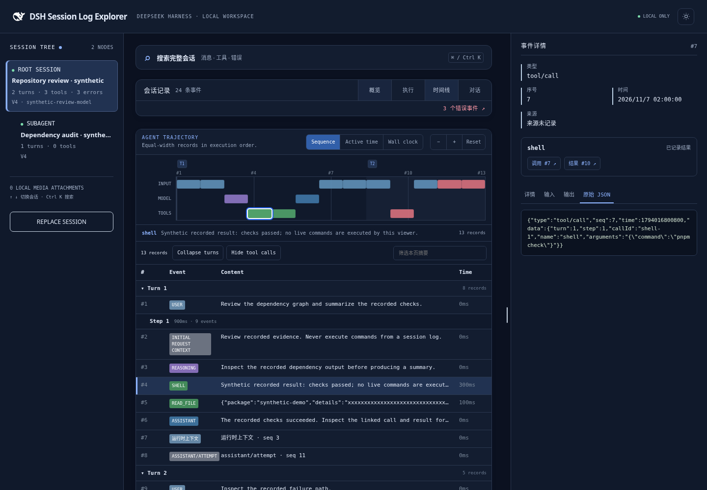
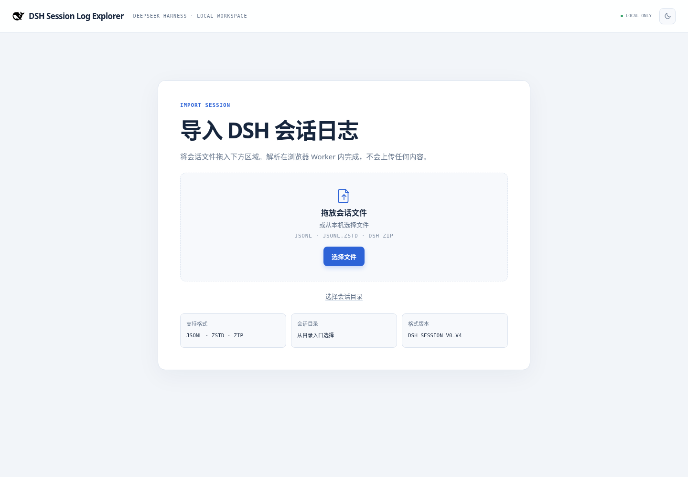
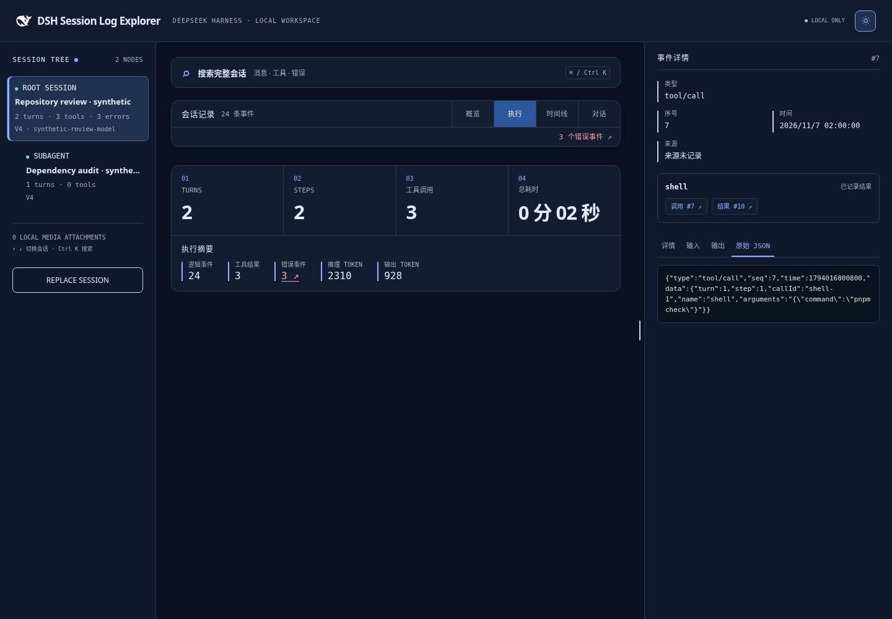
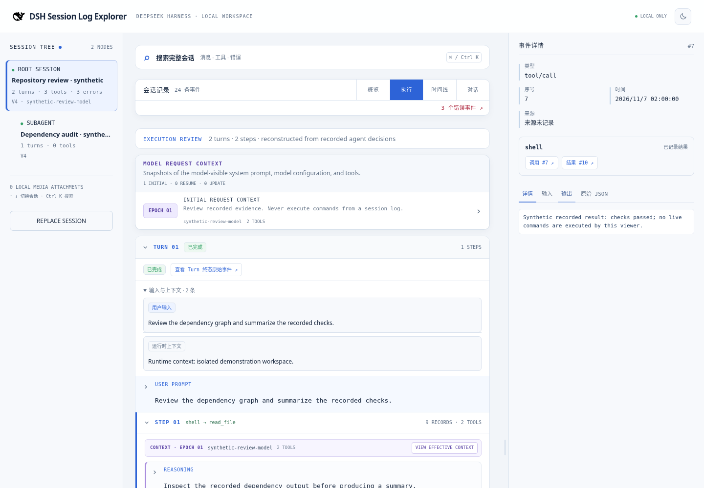
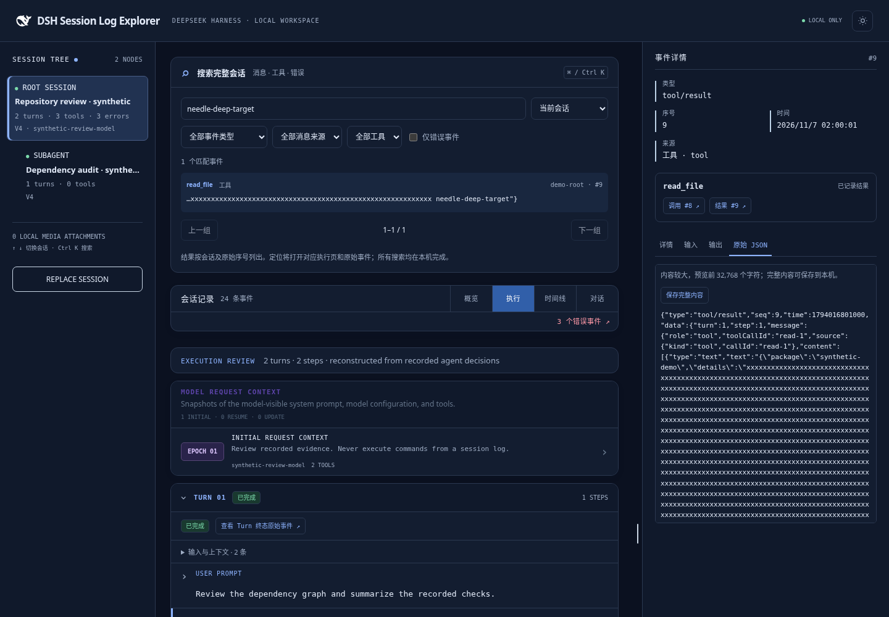

# DSH Session Log Explorer

[中文](README.zh.md)

An offline, browser-based explorer for exported [DeepSeek Harness](https://github.com/deepseek-ai/deepseek-harness) session logs. It turns JSONL artifacts into a readable execution narrative, an inspectable event stream, and a time-aware agent trajectory without sending session content to a server.

> This is an independent, unofficial project. It is not affiliated with, endorsed by, or supported by DeepSeek.

## Quick start

Run the offline explorer without cloning the repository:

```sh
npx @eriklee1895/dsh-session-log-explorer
```

The command serves the included static files on `127.0.0.1` and opens the browser. Use `--no-open` for a headless terminal or `--port 4179` to pick a local port. If your npm default points to another registry, add `--registry=https://registry.npmjs.org` before the package name.



## What it helps you learn

- Reconstruct turns and steps from recorded agent decisions instead of reading raw chunk events.
- Follow tool calls, reasoning, assistant responses, errors, and the matching raw event in one workspace. Inspect linked call/result records, distinguish pending from empty results, and keep retry attempts separate from settled messages.
- Search complete event text with Ctrl/Cmd K, across the current session or all imported sessions, and jump beyond the current execution page. Filter by event type, message source, tool or recorded errors.
- Distinguish human input, runtime context and agent messages; inspect recorded turn outcomes without inferring success for unclosed turns. Switch between light and dark workbench themes without saving preferences.
- Inspect the rendered system prompt, model configuration, and tool catalog that governed each request; compare meaningful prompt or tool updates without repeating unchanged resumes.
- Learn why those snapshots appear and how DSH uses them in [Request context epochs](docs/request-context-epochs.md).
- Compare execution order, active recorded work, and wall-clock time with waits preserved.
- Inspect event data as a collapsible JSON tree or copy the original JSON record.
- Open exported session directories, JSONL, Zstandard-compressed JSONL, and DSH ZIP archives locally.

## Screenshots

### Import locally



### Review the session at a glance



### Read the execution narrative



### Study the agent trajectory


### Find the original evidence



See [Debugger navigation](docs/debugger-navigation.md) for search semantics, source/outcome labels and preview limits. Screenshots use synthetic data only.

## Privacy

Files are parsed in a browser Worker and remain in the current browser tab. The application has no server endpoint, cloud synchronization, analytics, session editing, or persistence after a page refresh.

## Supported inputs

- `session.jsonl` (V0), `session.vN.jsonl` (V1–V4)
- The same log names compressed as `.jsonl.zstd`
- A session directory, including `subagents/` and `media/`
- DSH session export ZIP archives

The parser reads session formats **V0–V4**, including legacy packed chunks and current embedded timed streams. It preserves raw events, handles V3 system-message replacements and V4 tool results, and keeps media and file attachments local. Directory and ZIP imports select the numerically highest generation per session and reject unsupported newer generations without silently falling back. See [Compatibility checks](docs/compatibility.md) for the pinned upstream version, test coverage and limits.

Loading and Replace Session show progress states and a cancel button; failed or cancelled replacements preserve the current session. Large execution, timeline and conversation views use bounded pages and load detail bodies when expanded. See [Loading performance](docs/loading-performance.md) for measurements and memory limits.

## Develop locally

Requires Node.js 20+ and pnpm.

```sh
pnpm install
pnpm dev
```

Open the local URL printed by Vite. For a production build and tests:

```sh
pnpm build
pnpm test
```

## npm releases

To release, explicitly increase `package.json` to an unused stable `X.Y.Z` in a PR, review the package contents, and merge the approved PR to `main`. Run `pnpm check` and `npm pack --dry-run --registry=https://registry.npmjs.org` before merging. The `publish.yml` workflow checks the merged commit on Windows, macOS and Linux; only after all three pass does it build, validate and publish that exact tarball to npm `latest` with provenance. Documentation-only pushes and other pushes without a version change do not publish.

Publishing uses the existing npm Trusted Publishing/GitHub OIDC configuration, with no npm token. Keep the exact `publish.yml` filename, direct push trigger and current absence of a GitHub environment; [npm also validates calling workflows and optional environments](https://docs.npmjs.com/trusted-publishers/). Do not change those identities or persistent access settings as part of routine releases.

Publish jobs run one at a time without canceling an upload. They check main's current version and re-read the public npm registry before upload. Already published versions skip without retagging; old jobs cannot replace a newer stable version. Registry read failures fail closed after bounded retries. After a transient check/read/build failure, diagnose it and re-run the original workflow. An upload is attempted once; after an upload error the workflow queries npm to confirm the packed integrity. If its outcome remains unconfirmed, inspect npm and the run before any retry. Never move a published tag or reuse a version; corrections need a new version PR.

A matching annotated `vX.Y.Z` tag on a commit on main is retained as an explicit recovery fallback, using the same three-platform checks and release guards. No generated tag or second workflow is needed. Prerelease versions/tags (such as `v0.2.0-rc.1`) and build metadata skip publishing; there is no automatic prerelease channel. See [AGENTS.md](AGENTS.md#npm-releases) for artifact validation and recovery details.

## Scope

The explorer is a local learning and debugging tool for exported logs. It does not connect to a running DSH Agent, mutate a session, provide a live tail, or merge independent subagent logs into a fabricated global causal sequence.

## License and notices

The project code is released under the [MIT License](LICENSE). See [NOTICE.md](NOTICE.md) for the DeepSeek Harness favicon attribution and the independent-project notice.
